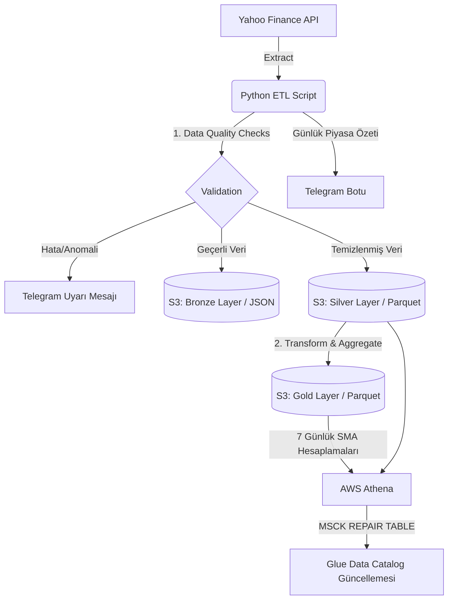

# 📈 Global Market Data ETL Pipeline & Telegram Bot


Bu proje, küresel finans piyasalarından (Borsa, Kripto, Döviz, Emtia ve ETF'ler) günlük verileri çeken, otomatik veri kalitesi (Data Quality) testlerinden geçiren, AWS S3 üzerinde **Medallion Mimarisi'ne (Bronze, Silver, Gold)** uygun şekilde arşivleyen ve sonuçları **Telegram üzerinden raporlayan** tam otomatik bir veri hattıdır (Data Pipeline).

## 🏗️ Mimari Şema ve Veri Akışı



## ✨ Temel Özellikler

* **Kapsamlı Veri Çekimi (Extract):** `yfinance` kütüphanesi kullanılarak BIST 100, S&P 500, Kripto Paralar (BTC, ETH), Emtialar (Altın, Petrol) ve Döviz kurları anlık olarak çekilir.
* **Veri Kalitesi ve Anomali Tespiti (Data Quality):** 
  * Eksik (Null) fiyat kontrolleri.
  * Ani düşüş/yükseliş tespitleri (-90% ile +500% arası makul kabul edilir).
  * Hatalı veriler Lake'e yazılmadan önce yakalanır ve Telegram üzerinden anında "Data Quality Alert" olarak bildirilir.
* **Medallion Veri Gölü Mimarisi (AWS S3):**
  * **Bronze (Raw):** Veriler hiçbir değişikliğe uğramadan denetim (audit) izi bırakmak için `JSON` formatında saklanır.
  * **Silver (Cleaned):** Veri tipleri düzeltilir, sıkıştırılmış `Snappy Parquet` formatında tarih/bölüntü (partition) bazlı kaydedilir.
  * **Gold (Analytics):** Analitik metrikler hesaplanır. Her varlık için 7 günlük Basit Hareketli Ortalama (SMA) ve bu ortalamadan sapma yüzdeleri hesaplanarak `Parquet` olarak yazılır.
* **AWS Athena Entegrasyonu:** S3'e yazılan verilerin Athena'da anında sorgulanabilmesi için `MSCK REPAIR TABLE` komutları otomatik tetiklenerek partition'lar güncellenir.
* **Telegram Bildirimleri:** Tüm işlemler bittiğinde piyasa durumunu içeren özet bir bülten Telegram grubuna/kanala gönderilir.

## 🛠️ Kullanılan Teknolojiler

* **Dil:** Python 3.10+
* **Kütüphaneler:** `boto3`, `yfinance`, `pandas`, `pyarrow`, `requests`
* **Bulut (AWS):** Amazon S3, Amazon Athena, AWS Glue
* **Bildirim:** Telegram Bot API

## 🚀 Kurulum ve Çalıştırma

### 1. Ön Gereksinimler

Projenin çalışması için bilgisayarınızda (veya sunucunuzda) aşağıdaki ortam değişkenlerinin (Environment Variables) tanımlı olması gerekmektedir:

* `AWS_ACCESS_KEY` : AWS IAM Kullanıcı Erişim Anahtarı
* `AWS_SECRET_KEY` : AWS IAM Gizli Anahtarı
* `TELEGRAM_TOKEN` : BotFather'dan alınan Telegram Bot Token'ı
* `TELEGRAM_CHAT_ID` : Mesajın gönderileceği kişi veya grup ID'si

*Not: `pipeline.py` içerisindeki `BUCKET_NAME` değişkenini kendi AWS S3 kovanızın ismiyle değiştirmeyi unutmayın.*

### 2. Bağımlılıkların Yüklenmesi

Projeyi klonladıktan sonra terminalde klasör dizinine gidin ve gerekli Python kütüphanelerini yükleyin:

```bash
pip install -r requirements.txt
```

### 3. Pipeline'ı Çalıştırma

Script'i manuel olarak başlatmak için terminalden şu komutu çalıştırabilirsiniz:

```bash
python pipeline.py
```

*Tavsiye: Bu scripti her gün piyasa kapanışında otomatik çalışması için **Cron Job**, **GitHub Actions** veya **AWS EventBridge + ECS/Lambda** yapılarına bağlayarak tam otonom hale getirebilirsiniz.*

## 📂 Veri Depolama Formatı (S3 Partitioning)

Büyük veri (Big Data) standartlarına uygun olarak veriler S3 içerisinde yıla, aya ve güne göre klasörlenir:
`s3://<bucket-adi>/silver/yil=2024/ay=11/gun=15/market_20241115_183000.parquet`

## 📄 Lisans
Bu proje açık kaynaklıdır ve MIT Lisansı ile lisanslanmıştır. İstenildiği gibi kullanılabilir ve geliştirilebilir.
